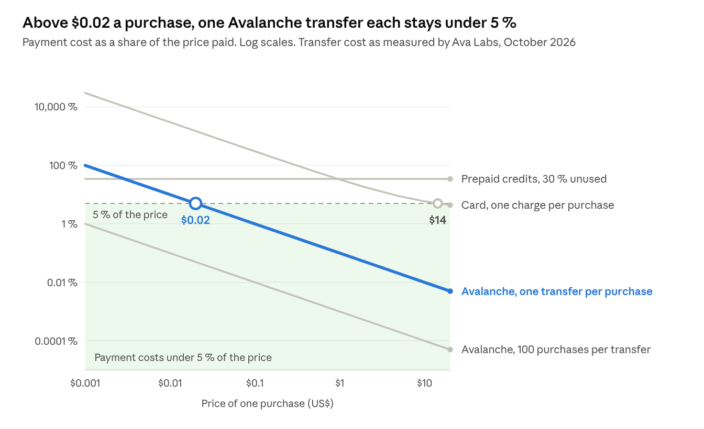
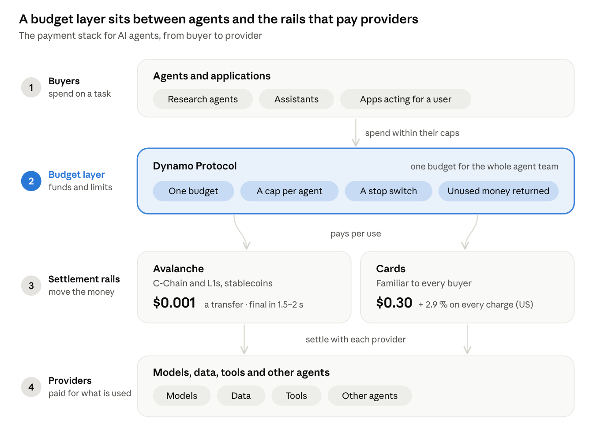

# The Economics of Agent Payments

*How payment costs change when software agents are the buyer, and what per-use payment requires. A joint paper by Ava Labs and Dynamo Protocol™.*

November 2026 · Graham Friedman, Ava Labs · Shawn Chequer, Dynamo Protocol

[Download the PDF](Economics-of-Agent-Payments.pdf)

## Summary

AI agents buy in many small amounts from many providers. For purchases of this kind, paying per use is usually the cheapest method, provided two pieces are in place: a low-fee settlement rail, and a budget layer above it.

- **Agents are a new kind of buyer.** One task can mean hundreds of purchases of a cent or less, from many providers, with no person approving each one.
- **Payment methods built for people don't fit.** Card fees swamp small payments; subscriptions and prepaid credits leave money unused, once per provider.
- **Fees and waste are both costs.** In a simple model, card payment costs fall below 5 % of the price only above about $14 a purchase. A low-fee rail moves that point to about $0.02, and grouping payments moves it lower still.
- **In a worked example,** $100 a month of agent purchases across 8 providers costs about $3,000 in card fees if each call is charged separately, leaves $60 unused with subscriptions or prepaid balances, and costs about $0.10 in network fees when paid per use on Avalanche.
- **Two layers make per-use payment work:** a settlement rail with low fees and fast finality, such as Avalanche, and a budget layer that lets one budget, with a cap for each agent and for every agent it hires, pay every provider. Dynamo Protocol provides the second.

## Agents are a new kind of buyer

People make a few purchases a day; an agent can make hundreds in a single task. A research agent might call search tools, data services, several AI models and other agents, paying a fraction of a cent to a few cents each time.

That changes what a payment system has to do well. It needs to handle very small amounts cheaply, pay many different providers, and work with no person approving each payment, so the limits have to be set before the work starts.

Early data bear this out. Chainalysis counted more than 138 million agent payments over the x402 protocol on Base, and more than 87 % of them were between $0.0001 and $0.10 ([Blockhead](https://www.blockhead.co/2026/10/15/ai-agents-have-made-138-million-payments-over-x402-most-of-them-under-10-cents/), October 2026).

Agents also hire other agents, which hire their own helpers. One task then becomes a tree of buyers, each spending on behalf of the one above it, and often belonging to different companies.

## Why today's payment methods fall short

Each familiar method hides its cost in a different place, and each cost grows with the number of providers an agent uses.

| Method | Where the cost hides | The problem for agents |
| --- | --- | --- |
| Card per payment | A fixed fee on every charge: 2.9 % + $0.30 for US cards | The fee is 30 times a one-cent purchase |
| Subscription | A flat monthly fee, used or not | Nearly 30 % of software spend goes unused (Gartner); one subscription per provider |
| Prepaid credits | A top-up fee, then a balance per provider | Money sits idle in many separate balances |
| Invoices | Contracts, credit checks and collections | Works for large customers, not for thousands of small agent buyers |

## A simple cost model

The real cost of paying for one purchase has three parts, and the visible fee is often the smallest.

> **Cost per purchase = F / N + r × p + w × p**

| Term | Meaning | Typical values |
| --- | --- | --- |
| F | Fixed fee per payment or settlement | $0.30 per US card charge; about $0.001 per stablecoin transfer on the Avalanche C-Chain (about 45,000 gas, measured by Ava Labs) |
| N | Purchases covered by one payment | 1 when each purchase is paid separately; many when payments are grouped, as with a prepaid balance |
| r | Percentage fee | 2.9 % on US cards; none on a stablecoin transfer |
| p | Price of one purchase | $0.001 to $1 for most agent purchases |
| w | Share paid but never used | Idle subscription capacity, stranded credits: up to about 30 % |

Cards fail on F, the fixed fee. Subscriptions and prepaid credits fail on w, the waste. Only per-use payment on a low-fee rail, with small purchases grouped into fewer payments, drives both close to zero.

## The break-even point

A low-fee rail moves the point where small payments make sense from about $14 down to about $0.02 a purchase.

*Cost model above. Inputs: Stripe US card pricing; about $0.001 per stablecoin transfer on the Avalanche C-Chain (Ava Labs measurement, October 2026); a $20 prepaid top-up with 30 % left unused.*

| How purchases are paid | Fee per payment | Payment costs fall below 5 % of the price above |
| --- | --- | --- |
| Card, one charge per purchase | 2.9 % + $0.30 | about $14 |
| Avalanche, one transfer per purchase | about $0.001 | about $0.02 |
| Avalanche, about 100 purchases per transfer | about $0.001 | about $0.0002 |

Grouping purchases is a familiar idea: prepaid balances and payment channels already do it. What remains for agents is the network overhead: an account, a subscription or a balance at every provider. A task that uses ten providers pays it ten times.

## A worked example

Consider a research agent that makes 10,000 calls a month at $0.01 each, spread across 8 providers: $100 of actual use.

| How it pays | Paid in the month | Of which, payment costs or unused |
| --- | --- | --- |
| Card, one charge per call | about $3,100 | about $3,000 in card fees |
| A $20 subscription at each provider, by card | about $167 | $60 of capacity unused; $7 in card fees |
| A $20 prepaid balance at each provider, by card | about $167 | $7 in top-up fees; $60 left across 8 balances |
| Per use from one budget, in stablecoins on Avalanche | about $100 | about $0.10 in network fees; nothing left idle |

The subscription and prepaid figures differ in one respect: unused subscription capacity is lost, while a prepaid balance carries over but stays tied to one provider. The last row assumes provider payments are grouped into about 100 transfers over the month, in the familiar way described above, at about $0.001 each; even one transfer per call would cost only about $10 in the month. It excludes the one-off cost of funding the budget, and money left in the budget goes back to the funder.

The gap widens as conditions change. If the agent's usage halves, the per-use cost halves with it, but the subscriptions don't. If the agent adds a ninth provider, the per-use row is unchanged, while the other two add another account and another $20.

## When agents hire agents

The overhead multiplies when agents hire other agents: every hired agent needs its own way to pay. Take the research agent above, now run as an orchestrator that hires three specialist agents, each using the same 8 providers.

| How the team pays | Accounts or balances to manage | Money committed in advance |
| --- | --- | --- |
| Each agent holds its own subscriptions or prepaid balances | 24 (3 agents × 8 providers) | about $480 at $20 each |
| One budget, a cap for each agent, paid per use | 1 budget, 4 caps | only what is used; the rest returns to the funder |

Cost is only half of it. When something goes wrong deep in the tree, the person who funded the work needs to know which agent spent what, on whose authority, and to be able to stop that branch without stopping the rest. Payment methods built for one payer and one payee cannot answer that; a budget layer can.

## Two layers that make per-use work

Per-use payment for agents needs a rail that makes small payments cheap and final, and a budget layer that makes them easy to fund and control.

*The payment stack for agents, in four layers.*

### The settlement layer: Avalanche

- **Low fees:** a stablecoin transfer on the C-Chain cost about $0.001 when Ava Labs measured it in October 2026 (about 45,000 gas, to a recipient that already holds the coin; a first transfer to a new holder costs more).
- **Fast, final settlement:** since the Helicon upgrade, the C-Chain and Avalanche L1s average 1.5 to 2 seconds to finality (Ava Labs, October 2026), and a finalised block is not reorganised.
- **Predictable costs:** the Octane upgrade (ACP-103) made the C-Chain's fees adjust dynamically with demand, which dampens price spikes.
- **Standard tooling:** the C-Chain runs the Ethereum Virtual Machine, so widely used stablecoins, wallets and developer tools work without changes.
- **Dedicated capacity:** an application with high volume can run its own Avalanche L1, with its own fee rules, and still exchange messages and assets with the C-Chain.

Finality matters more for machine buyers than for people. A provider serving an agent it has never dealt with can release the work as soon as payment is final, with no chargeback window to price in.

### The budget layer

A budget layer sits between agents and the rail. It addresses the per-provider overhead described above, and the fact that no person approves each payment. Dynamo Protocol provides this layer; in outline, it offers:

- **One budget across providers:** a team of agents draws on a single budget, however many providers it uses, instead of an account and a balance at each.
- **A cap for each agent, and for the agents it hires:** limits are set before the work starts. An agent can hire helpers, including other companies' agents, only within its own cap, and limits narrow at every level.
- **Payment per use, in both directions:** agents pay models, data, tools and other agents for what they use, including through x402; providers and agents get paid per request the same way.
- **Stop at any level:** one main switch pauses all new spending at once, or one branch can be stopped with everything below it. Finished work is paid first.
- **Unused money returned:** whatever isn't spent flows back up every level to whoever funded the budget, rather than staying with providers.
- **End users can fund their own work:** an app's customers can fund a budget for their job, and the same budget pays the providers the app uses for that job.
- **A signed record of every payment:** who authorised it, under which budget, so finance teams and auditors can check the spending afterwards.
- **Familiar methods:** credit card payments and stablecoins, and the agent frameworks developers already use.

The two layers are independent: either can be used without the other. The economics described in this paper come from using both.

## Where per-use payment does not win

Per-use payment is not the cheapest choice everywhere.

- **Steady, heavy use.** When an agent's use of one provider is high and predictable, a flat subscription can cost less.
- **Large purchases.** Above about $14, card fees fall under 5 % of the price, and cards bring chargeback protection that buyers value.
- **Finality cuts both ways.** It protects providers; buyers rely on limits set in advance rather than on disputes after the fact.
- **Fees vary.** Network fees rise with demand. The figures here assume normal conditions on the C-Chain.
- **Operations and rules.** Holding and accounting for stablecoins, and the rules that apply to them, differ by country and by company.

## Implications

- **For developers building agents:** the cost of paying, not only the price, decides which providers an agent can use economically. Pooling spend in one budget, with a cap per agent, removes the per-provider overhead.
- **For providers selling to agents:** per-use settlement on a final rail makes it possible to sell to agents with no contract, invoice or credit check.
- **For settlement networks:** agent payments are a high volume of small transfers, which favours networks with low, stable fees and fast finality.
- **Further work:** later joint papers are planned on the agent payments stack, settlement finality for machine payments, and keeping agents' spending safe.

## About the authors

Ava Labs builds Avalanche, a network of interoperable blockchains: the C-Chain and independent L1s ([avax.network](https://www.avax.network/)). Author: Graham Friedman.

Dynamo Protocol provides budgets, spending caps and per-use payment for networks of AI agents, in preview today ([dynamo.zone](https://dynamo.zone/)). Author: Shawn Chequer.

Dynamo Protocol is a trademark of its owner.

## Sources

- [AI agents have made 138 million payments over x402](https://www.blockhead.co/2026/10/15/ai-agents-have-made-138-million-payments-over-x402-most-of-them-under-10-cents/) (Blockhead, 2026-10-15, reporting Chainalysis): agent payment volume and size
- [Stripe pricing breakdown 2026](https://flexprice.io/blog/stripe-pricing-breakdown-2026) (Flexprice): US card fees
- [Unused SaaS licenses](https://www.toriihq.com/articles/unused-saas-licenses) (Torii, citing Gartner): unused software spend
- Ava Labs (Graham Friedman), October 2026: measured stablecoin transfer cost on the C-Chain (about 45,000 gas, about $0.001) and finality after the Helicon upgrade (1.5 to 2 seconds)
- [Avalanche Octane](https://docs.avax.network/blog/octane-optimizing-c-chain-gas-fees) (Avalanche): the fee mechanism
- Worked examples: authors' calculation from the card and transfer prices above; the subscription and prepaid amounts and the example agent are illustrative.
